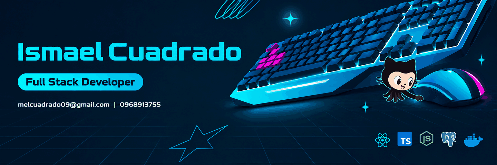
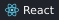

# Hola, soy Ismael Cuadrado 👋

## 👨‍💻 Sobre mí

Soy estudiante de **Ingeniería en Software** en Ecuador y actualmente estoy cursando el **octavo semestre**. Me enfoco en el desarrollo **Full Stack**, desde la interfaz y las API hasta la base de datos y el despliegue.

- **Me interesa:** automatizar procesos e integrar inteligencia artificial en aplicaciones web y dar soluciones .
- **Idiomas:** 🇪🇨 Español — Nativo · 🇬🇧 Inglés — B1
---

## 🛠️ Stack tecnológico

### Lenguajes de programación

      

### Frontend

    

### Backend

    

### Bases de datos

   

### Infraestructura y herramientas

    

### Automatización e inteligencia artificial

  

---

## 📊 Estadísticas de GitHub

---

## 🚀 Proyecto destacado

### iCASE · De requisitos a aplicaciones web

Trabajo en una herramienta que analiza documentos PDF para identificar requisitos y actores, genera diagramas y prototipos de interfaz, y usa esos modelos como base para generar código frontend y backend.
